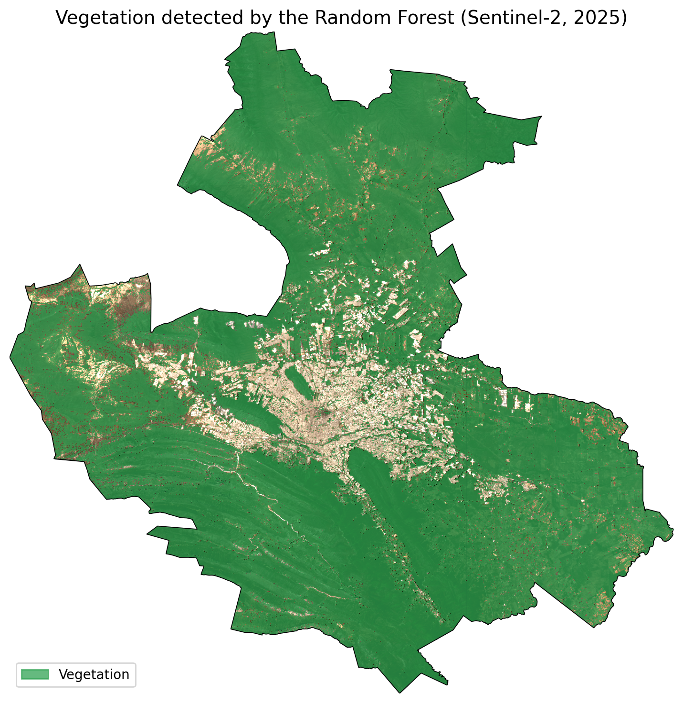
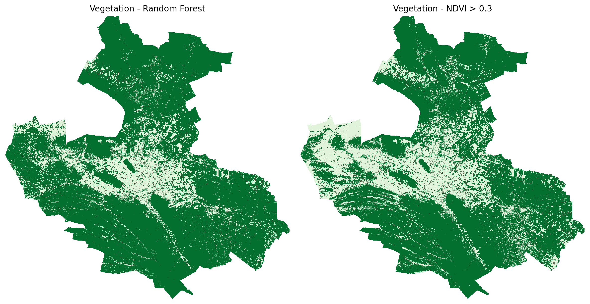
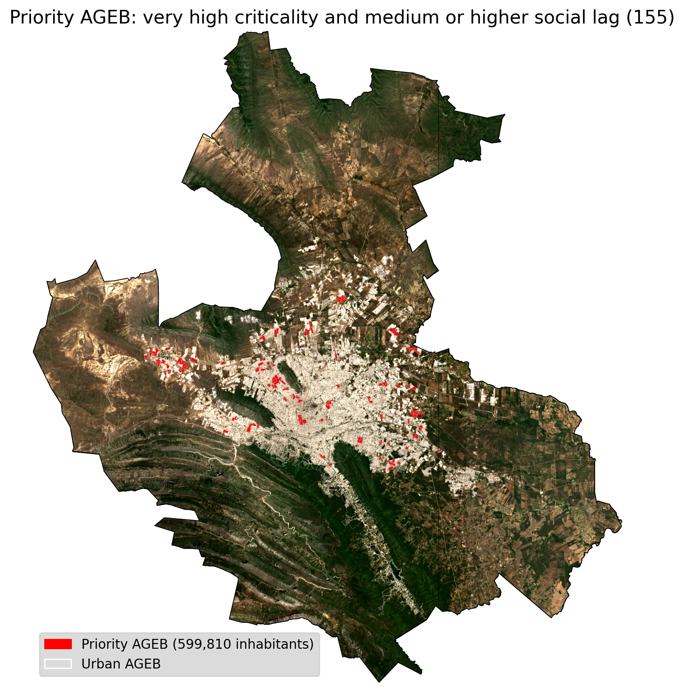
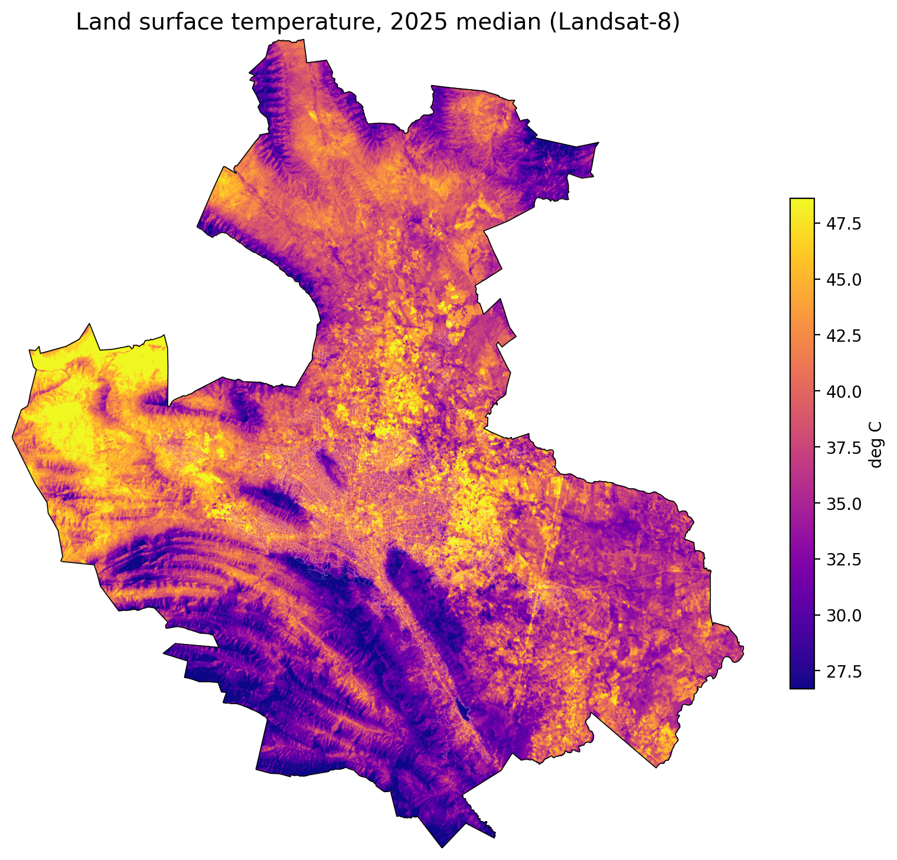

# Green areas and heat in the Monterrey Metropolitan Area

This project maps vegetation in the Monterrey Metropolitan Area (ZMM) using Sentinel-2 images and a Random Forest classifier, and then combines it with population, social lag and surface temperature data to find the urban AGEB (census tracts) with the most critical conditions.

It was the data analysis part of my final degree project in Industrial Physics Engineering at Tecnológico de Monterrey (2025). The project was the prototype of an Earth observation nanosatellite, built by a team, and I was in charge of the data analysis. Part of the analysis was originally done in QGIS; in this repository all the steps are done in Python and compared with the QGIS results.



## Results

### Vegetation classifier

The model was trained with 1,138,928 pixels that I labeled by hand on 49 Sentinel-2 tiles. In the original project it was evaluated with a random 80/20 split of the pixels, but neighbouring pixels of the same tile end up in both train and test (and the 3x3 filter mixes them), so that score is too optimistic. I evaluated it again leaving out whole tiles and whole quadrants, and compared it with a simple rule, NDVI > 0.3:

| Evaluation | Balanced accuracy | Recall, no vegetation | Recall, vegetation |
|---|---|---|---|
| Random pixel split (original) | 0.961 | 0.939 | 0.982 |
| Leaving out tiles (5 folds) | 0.940 | 0.908 | 0.973 |
| Leaving out quadrants (9 folds) | 0.917 | 0.855 | 0.978 |
| NDVI > 0.3, no training | 0.942 | 0.918 | 0.966 |

On areas it has not seen, the Random Forest is not better than the NDVI threshold. Both detect vegetation well, the difference is in what is not vegetation. The worst quadrants are C4 and C7, where many non vegetation pixels are classified as vegetation; in the mountain tiles of C4 these are mostly rock and shadows. Most of the non vegetation labels (80%) come from the city center, so the model saw very few examples of bare soil or rock. This is also visible in the full map: the model marks 82.2% of the ZMM as vegetation and NDVI marks 72.8%, and most of the difference is in the dry area to the north-west.



### AGEB indicators

For the 2,155 urban AGEB of the ZMM (5.25 million inhabitants) I calculated the green area inside each AGEB and within 500 m, green per inhabitant, the surface temperature compared with the urban mean, an environmental criticality index and a Green Score.

155 AGEB, with 599,810 inhabitants (11.4% of the ZMM), have very high criticality and a medium or higher social lag, these are the priority AGEB. Compared with the rest of the populated AGEB, they have about twice the population density (15,700 vs 8,200 inhabitants per km²), much less green per inhabitant (2.9 vs 14.0 m²) and they are 2 °C hotter than the urban mean.

When the QGIS zonal statistics are used as input, the code gives exactly the same indicators as QGIS. With the new vegetation map, 152 of the 155 priority AGEB were also priority in the original QGIS analysis (174).





## Limitations

- The validation uses the training tiles (C1-C9). The model was then applied to a second export of the whole ZMM (Q11-Q33) with the same collection and bands, but those tiles are not directly validated.
- There are few labels of bare soil, rock and dry scrub, which is where the model fails.
- The access part of the Green Score is saturated. It counts every vegetation pixel within 500 m (parks, gardens, hills, empty lots), so every populated AGEB is above the 9 m² per inhabitant target and that index is 100 everywhere. In practice the Green Score depends only on coverage and green per inhabitant.
- Priority AGEB are the ones with very high criticality and medium or higher social lag. 153 of the 155 have medium social lag.
- The Random Forest results change a little between scikit-learn versions (0.917 with 1.7.2 and 0.930 with 1.9.1 leaving out quadrants). The numbers here use the versions in requirements.txt.
- In the final QGIS layer the population column was overwritten with 0 and 1 by mistake. The indicators had already been calculated with the real population, but here the population is always taken from the census.

## Method

1. `01_sentinel_download.ipynb`: downloads the 2025 Sentinel-2 median mosaic of the ZMM from Google Earth Engine (January to November, less than 5% clouds, clouds and shadows masked with SCL, bands B2, B3, B4, B8, B8A, B11 and B12 at 10 m), split in 9 quadrants of 15x15 tiles. It also has the Landsat-8 surface temperature (2025 median in °C, 30 m). The original temperature script was not saved, so that cell was written again from the parameters in my project notes.
2. `02_model_validation.ipynb`: applies a 3x3 gaussian filter to each band and calculates 13 features (the 7 bands, NDVI, NDWI, NBR, RENDVI, VARI and ExG). Trains a Random Forest with 200 trees and balanced class weights, runs the three validations and the NDVI comparison, and trains the final model with all the labels.
3. `03_prediction.ipynb`: classifies the 2,025 tiles of the ZMM with the model and with NDVI, joins them in a mosaic and clips it to the ZMM.
4. `04_ageb_indicators.ipynb`: zonal statistics by AGEB and 500 m buffer, indicators, criticality index, CONEVAL filter, Green Score and comparison with QGIS.
5. `05_maps.ipynb`: final maps over the Sentinel-2 true color mosaic.

The labels were drawn with `mask_tool.py`, a polygon tool made with OpenCV. Shared functions are in `utils.py` and all the paths in `config.py`.

The criticality index follows the idea of the Heat Vulnerability Index (exposure, sensitivity and adaptive capacity): crit_amb = density quintile + temperature quintile + (6 - access quintile). It goes from 3 to 15 and 12 or more is very high.

The Green Score is (coverage index + green per inhabitant index + 2 x access index) / 4, where each index goes from 0 to 100 with targets of 30% coverage, 30 m² per inhabitant and 9 m² per inhabitant.

## Data

Only the training data is in the repository: the masks and the 49 labeled tiles (data/raw/training_masks and data/raw/training_tiles, 31 MB), enough to run notebook 02. The rest of the data (about 1.5 GB) comes from:

| Data | Source | Folder |
|---|---|---|
| Sentinel-2 L2A | Google Earth Engine, COPERNICUS/S2_SR_HARMONIZED (notebook 01) | data/raw/sentinel2, data/raw/training_tiles |
| Vegetation labels | Drawn by hand | data/raw/training_masks |
| Surface temperature | Landsat-8 Collection 2 Level 2, band ST_B10, Google Earth Engine (notebook 01) | data/raw/lst |
| AGEB polygons | INEGI, Marco Geoestadístico | data/raw/inegi |
| Population | INEGI, Censo de Población y Vivienda 2020, results by AGEB | data/raw/inegi |
| Social lag | CONEVAL, Grado de Rezago Social por AGEB urbana 2020 | data/raw/coneval |
| ZMM boundary | INEGI, 16 municipalities | data/raw/boundaries |

## How to run

```
conda create -n urban-green -c conda-forge python=3.12 -y
conda activate urban-green
pip install -r requirements.txt
jupyter lab
```

With the data in data/raw, run the notebooks 02, 03, 04 and 05 in order (01 is only needed to download the images again). Notebook 02 takes about 1.5 hours and 03 about 1 hour. The notebooks are saved with their outputs, so the results can also be read directly on GitHub.

## Structure

```
01_sentinel_download.ipynb
02_model_validation.ipynb
03_prediction.ipynb
04_ageb_indicators.ipynb
05_maps.ipynb
config.py           paths
utils.py            image reading and features
mask_tool.py        labeling tool
requirements.txt
results/            tables and figures
data/raw/           training masks and tiles
```

## Resumen en español

Mapa de vegetación de la Zona Metropolitana de Monterrey con imágenes Sentinel-2 y un clasificador Random Forest, entrenado con 1.14 millones de píxeles etiquetados a mano. El mapa se cruzó con el Censo 2020, el rezago social de CONEVAL y la temperatura superficial de Landsat-8 para identificar las AGEB urbanas más críticas. Evaluado en cuadrantes que no vio, el modelo tiene una exactitud balanceada de 0.917, por debajo de un umbral simple de NDVI (0.942). Se identificaron 155 AGEB prioritarias con 599,810 habitantes. Fue la parte de análisis de datos de mi proyecto final de Ingeniería Física Industrial en el Tec de Monterrey (2025).
